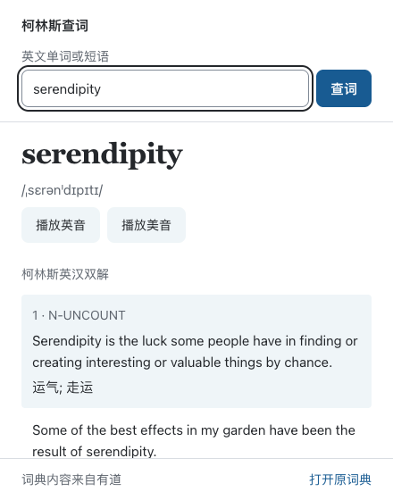

# 柯林斯查词

一个轻量的 Manifest V3 Chrome 扩展。在工具栏弹窗输入英文单词或短语，查看柯林斯英汉双解释义、中英例句、音标和英美发音。没有柯林斯条目时，显示有道基础释义或拼写候选。

A minimal Chrome extension for Collins dictionary lookups via Youdao. Popup search, bilingual definitions and examples, phonetics, and British/American pronunciation. No build step required.



## 功能

- 输入英文单词或短语，按 Enter 查词。
- 按义项显示柯林斯释义和中英例句。
- 点击播放英音或美音。
- 没有柯林斯条目时，回退到有道基础释义。
- 自动跟随系统亮暗主题，长结果可滚动阅读。
- 网络失败、超时或查无结果时，提供提示和原词典链接。

只做弹窗查词，不包含网页划词、账号、生词本或扇贝同步。

## 安装

1. 在本仓库点击 **Code → Download ZIP**，并解压下载的文件。
2. 在 Chrome 地址栏打开 `chrome://extensions`。
3. 打开右上角「开发者模式」。
4. 点击「加载已解压的扩展程序」。
5. 选择包含 `manifest.json` 的解压目录。
6. 在工具栏的扩展菜单中固定「柯林斯查词」。
7. 点击图标，输入英文单词或短语，按 Enter 查词。

也可以克隆仓库后直接加载：

```sh
git clone https://github.com/jiagenli/youdao-collins-extension.git
```

无需 npm 安装或构建。关闭弹窗会结束查询，下次打开从空白搜索开始。当前安装方式是加载已解压的扩展，尚未上架 Chrome Web Store。

## 数据与权限

只请求 `https://dict.youdao.com/`。不读取浏览标签、网页内容或登录 Cookie，不使用生词本、账号、历史记录、扇贝或网页划词。词典请求发送所输入的查询，音频请求发送播放的单词。扩展不运行后台进程。

沿用原插件的有道旧词典页面来源并改用 HTTPS。这是网页解析，没有稳定性承诺。上游改版可能需要调整解析器。接口失败、查无结果和发音错误均有提示，可打开原词典。

此项目复刻查词功能，不代表有道或 Collins 官方产品。开源软件许可不授权再分发词典内容；本扩展按查询读取网页，不附带词典数据库。

## 开发与验证

- `popup.html` / `popup.css`：弹窗结构、亮暗主题和滚动布局。
- `popup.js`：查询状态、结果渲染、请求取消和音频播放。
- `dictionary.js`：输入校验、查询地址和有道页面解析。
- `manifest.json`：扩展配置和词典域名权限。

修改后，在 `chrome://extensions` 中点击扩展的刷新按钮，再重新打开弹窗。

初版已在 Chrome 中验证 `hello`、`run`、`deficits`、`serendipity` 的真实查词，以及 `kubernetes` 的基础释义回退；也验证了音频下载和解码、亮暗主题、长结果滚动、无结果、断网、HTTP 错误、超时和新查询取消旧查询。当前未配置自动化 CI。

## 致谢与许可

功能受到 [oyyd/youdao-collins-chrome-extension](https://github.com/oyyd/youdao-collins-chrome-extension) 启发。词典选择器与义项结构参考其 `src/parse.js`。保留原作者 Ouyang Yadong 的 MIT 版权声明。

本项目代码使用 [MIT License](LICENSE)。该许可只覆盖软件代码，不覆盖上游词典内容。
